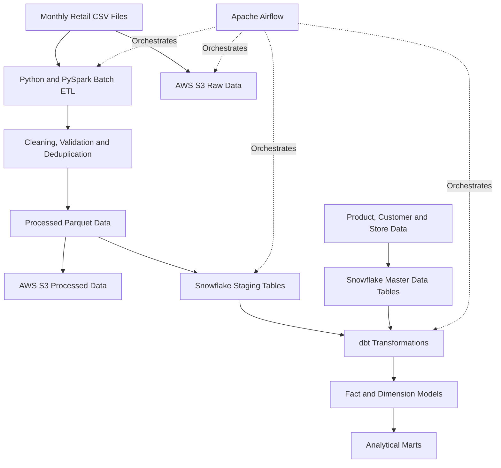

# Retail Analytics Warehouse

An end-to-end data engineering project that transforms retail sales data into analytics-ready datasets using **Python, PySpark, Apache Airflow, AWS S3, Snowflake, and dbt**.

The pipeline automates batch ingestion, data cleaning, validation, deduplication, cloud storage, warehouse loading, dimensional modeling, and data quality testing.

## Project Highlights

- **10,000 sales transactions** processed across January–December 2025.
- **8 analytical tables** created in the Snowflake `ANALYTICS` schema.
- **33 dbt data tests passed**, with zero warnings and zero errors.
- **6 Airflow tasks** orchestrate the end-to-end workflow.
- **10,000 unique transaction IDs** verified in the `FACT_SALES` table.
- AWS S3 provides cloud storage for raw sales files and processed Parquet data.

## Architecture



### Architecture Components

| Component | Responsibility |
|---|---|
| Python | Data generation and pipeline utilities |
| PySpark | Batch processing, cleaning, validation, and deduplication |
| AWS S3 | Storage for raw CSV and processed Parquet data |
| Snowflake | Cloud data warehouse and analytical storage |
| dbt Core | SQL transformations, dimensional modeling, and data testing |
| Apache Airflow | Workflow scheduling, dependencies, retries, and monitoring |
| Docker | Containerized development environment |

## Pipeline Workflow

The Airflow DAG, `retail_warehouse`, coordinates six tasks:

1. **Batch ETL** — Reads retail sales CSV files, applies cleaning and validation rules, handles duplicate transaction IDs, and generates processed Parquet data.
2. **Upload to S3** — Uploads raw and processed datasets to the configured AWS S3 bucket.
3. **Load Master Data** — Loads product, customer, and store reference data into Snowflake.
4. **Load Sales Data** — Loads sales transactions into Snowflake with transaction-level validation and merge logic.
5. **Run dbt** — Builds staging and intermediate models, dimensions, the sales fact table, and analytical marts.
6. **Test dbt Models** — Executes automated data quality checks against the transformed datasets.

Airflow manages task dependencies, execution status, retries, and monitoring.

## Data Modeling

The Snowflake `RETAIL_DB.ANALYTICS` schema contains eight verified analytical tables.

| Table | Purpose |
|---|---|
| `FACT_SALES` | Retail transaction fact table |
| `DIM_DATE` | Date-based analysis |
| `DIM_PRODUCTS` | Product attributes and analysis |
| `DIM_CUSTOMERS` | Customer attributes and analysis |
| `DIM_STORES` | Store attributes and analysis |
| `MONTHLY_SALES_SUMMARY` | Monthly sales metrics |
| `PRODUCT_PERFORMANCE` | Product-level performance metrics |
| `STORE_PERFORMANCE` | Store-level performance metrics |

The dimensional model supports analytical queries across dates, products, customers, and stores.

## Data Quality and Validation

The pipeline applies data quality checks throughout processing and transformation.

- Transaction-level validation and duplicate handling.
- Required-field and null checks.
- Unique transaction ID validation.
- Accepted-value and relationship checks in dbt.
- Snowflake fact-table row count and uniqueness verification.
- Automated dbt test execution through Airflow.

### Verified Results

| Metric | Result |
|---|---:|
| Source sales period | January–December 2025 |
| Processed transactions | 10,000 |
| Unique transaction IDs | 10,000 |
| Analytical tables | 8 |
| dbt tests passed | 33 |
| dbt warnings | 0 |
| dbt errors | 0 |
| Final Airflow run | Successful |

These results were verified against Snowflake query results and the successful Airflow task logs.

## Technology Stack

- **Languages:** Python, SQL
- **Processing:** PySpark
- **Orchestration:** Apache Airflow
- **Cloud Storage:** AWS S3
- **Data Warehouse:** Snowflake
- **Transformation and Testing:** dbt Core
- **Containerization:** Docker
- **Version Control:** Git and GitHub

## Project Structure

```text
Retail_Analytics_Warehouse/
├── dags/
│   └── retail_warehouse.py
├── dbt/
│   ├── models/
│   │   ├── staging/
│   │   ├── intermediate/
│   │   └── marts/
│   ├── macros/
│   └── dbt_project.yml
├── screenshots/
├── sql/
├── src/
│   ├── batch_etl.py
│   ├── generate_retail_data.py
│   ├── load_master_data.py
│   ├── s3_uploader.py
│   └── snowflake_loader.py
├── tests/
├── .gitignore
└── README.md
```

Local configuration files, credentials, virtual environments, and generated data are excluded from version control where appropriate.

## Project Screenshots

The screenshots below are stored in the repository and can be opened directly from GitHub.

### Screenshot 1


### Screenshot 2


### Screenshot 3


### Screenshot 4


### Screenshot 5


## Skills Demonstrated

- Batch data engineering and ETL development
- PySpark data transformation and validation
- Apache Airflow DAG development and orchestration
- AWS S3 data lake integration
- Snowflake data loading and dimensional modeling
- dbt model development and automated testing
- SQL-based data validation and analytical preparation
- Docker-based development workflows
- Git and GitHub version control

## Future Enhancements

- Implement incremental processing and automated recovery for failed batches.
- Add CI/CD validation for Python, SQL, and dbt changes.
- Introduce monitoring dashboards and data freshness checks.
- Extend the pipeline with additional analytical datasets.

## Author

**Amit Kumar Chaudhary**

Data Engineering | Python | SQL | PySpark | Apache Airflow | AWS | Snowflake | dbt

- **GitHub:** [Amit5eng](https://github.com/Amit5eng)
- **Project Repository:** [Retail Analytics Warehouse](https://github.com/Amit5eng/Retail-Analytics-Warehouse)
